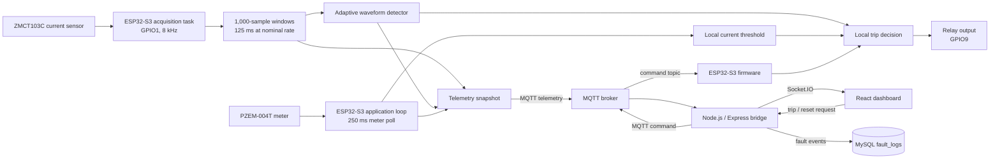
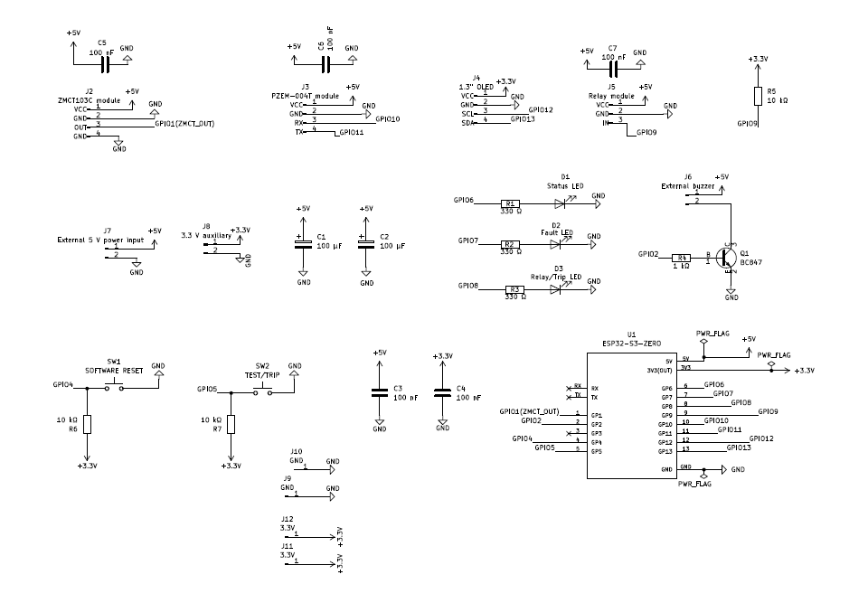

# SafeNetQ

**Real-time monitoring and relay-based protection for power distribution systems using IoT and adaptive HIF detection.**

[](#project-status)
[](#firmware-and-hardware)
[](#firmware-and-hardware)
[](#web-dashboard)
[](#telemetry-and-services)
[](#database)
[](#testing-and-validation)
[](./LICENSE)

SafeNetQ is an academic bench prototype that combines local current monitoring and relay control with live telemetry, adaptive waveform analysis, and a browser dashboard. Its HIF detector studies current-waveform shape so it can flag sustained changes that a simple fixed threshold may miss. Local protection logic runs on the ESP32-S3; the bridge and dashboard provide monitoring, event history, and supervisory commands.

> **Safety:** SafeNetQ is not certified protective equipment. It must not replace or bypass a correctly rated MCCB, AFCI, or other required protection. Do not connect this prototype to an energized building or public distribution circuit. Test only on an isolated, current-limited bench under qualified supervision. Firmware thresholds are experimental defaults, not approved protection settings.

## Project status

This repository describes **SafeNetQ V0.1**. The current tree contains ESP32-S3 firmware, a Node.js MQTT/Socket.IO bridge, a React dashboard, SQL setup scripts, and basic simulation/UI scripts. It is a research prototype and has not been shown here to meet a protection-device certification or field-deployment standard.

The HIF detector is configured to warn by default. The firmware's separate PZEM current threshold can trip the relay locally. MQTT connectivity is not required for the local current-threshold path. A fault condition, detector alarm, relay operation, or command acknowledgement shown by the app should not be treated as proof of safe isolation.

## Why SafeNetQ

A high-impedance fault can draw too little or too irregular a current to operate conventional overcurrent protection promptly. At the same time, normal nonlinear loads such as dimmers and switched-mode power supplies can distort current waveforms and confuse a detector that relies on one fixed waveform threshold. SafeNetQ explores per-load waveform baselines and persistent change scoring as an additional monitoring layer.

SafeNetQ is intended to work **alongside** conventional protection. It does not replace an MCCB, determine that a circuit is safe to touch, or guarantee detection of every HIF. The ZMCT103C signal and detector features require calibration and controlled validation for the actual sensor circuit and load.

## Architecture



The firmware publishes to `safenetq/telemetry/v1` and listens for commands on `safenetq/command/v1`. The bridge subscribes to the telemetry topic, broadcasts live updates to connected browsers, and writes recognized fault events to MySQL when the database is available. Dashboard command acknowledgement means the MQTT broker accepted a publish; it does not confirm that the device received the request or that the relay changed state.

## Firmware and hardware

### Sampling and detector

- The ZMCT input is sampled at a nominal **8 kHz** (`125 µs` per sample). The acquisition task collects **1,000 samples** per feature window, approximately **125 ms**.
- The code derives nine time-domain values without a heavy FFT: five cycle-to-cycle irregularity values (`PeakCV`, `WidthCV`, `Jitter`, `ShapeShift`, `Roughness`) and four lobe-shape values (`Width`, `Crest Factor`, `Asymmetry`, `Edge / di-dt`). These are names used by the firmware/dashboard; they are not nine independent fault types.
- The detector moves through `NO LOAD`, `SETTLE`, `LEARN`, `ARMED`, and `UNSTABLE`. It builds an adaptive per-load feature baseline using online mean/variance updates (Welford-style updates), then scores changes against that baseline. A load change can return the detector to settle and learn again.
- Firmware constants use a 24-window rolling hit count, warning at 5 hits and alarming at 9; the CUSUM warning and trip thresholds are 10 and 30. The HIF action defaults to warning-only. Relay tripping for HIF requires the firmware's HIF mode to be set to `trip` and the alarm conditions to be met.
- The PZEM current path is separate from the HIF score. Its default limit is **5 A**, with a **300 ms** inrush blanking period, a **500 ms** sustained-over-limit timer, and an immediate trip threshold at **1.5×** the configured limit. These are code defaults for bench evaluation, not safe operating recommendations.
- PZEM values are polled every **250 ms**. PZEM loss is configured not to trip in the current firmware.

The ZMCT acquisition and MQTT worker tasks are pinned to ESP32 core 0 in the source. The Arduino `loop()` handles PZEM polling, detector updates, relay decisions, serial commands, and the OLED; this processing should be timed and validated on the exact board and firmware build before relying on it.

### Firmware pin map

| ESP32-S3 GPIO | Firmware assignment | Notes |
| --- | --- | --- |
| GPIO1 | ZMCT103C analog output | Configure the analog front end and attenuation for the board's safe input range. |
| GPIO9 | Relay module input | Firmware defines an active-high relay output. Confirm this matches the installed module. |
| GPIO10 | PZEM UART receive | Receives the meter's transmit data. |
| GPIO11 | PZEM UART transmit | Sends data to the meter's receive input. |
| GPIO12 | OLED I²C SCL | SH1106 display bus. |
| GPIO13 | OLED I²C SDA | SH1106 display bus. |
| GPIO0 | Button input | Short press changes the OLED page or resets a latched trip; hold over 1.2 s requests detector relearning. GPIO0 is also a boot-strapping pin. |

The supplied schematic also labels GPIO2 for a buzzer driver, GPIO4 and GPIO5 for reset/test buttons, and GPIO6–GPIO8 for LEDs. Those auxiliary assignments are **not configured in the current firmware source**, which uses GPIO0 for its button input. Resolve this schematic/firmware mismatch and verify the physical board pinout before wiring or testing. The schematic is a design reference, not a validated wiring instruction.

### Schematic



## Web dashboard

The page's primary title is **SafeNetQ**. Its supporting line is **“Real-Time Monitoring and Relay-Based Protection for Power Distribution Systems Using Adaptive Baseline Learning.”** The dashboard currently has two segmented views: **SafeNetQ Telemetry** and **Relay & Fault Logs**. These are UI views, not authenticated user roles or separate routes.

The React frontend includes:

- A dark command-center palette with layered blue, cyan, teal, and violet aurora fields.
- A scroll-pinned canvas introduction showing a stylized distribution-line sequence, current-flow cues, a SafeNetQ safety mark, and a scroll-driven title reveal. The canvas illustration is procedural artwork, not a physically accurate electrical simulation or 3D model.
- A kinetic-flowfield title treatment, animated on scroll and hover, plus a blurred glass segmented view switcher with a sliding accent indicator.
- Live bridge, MQTT, and MySQL status badges; system condition indicators; detector state; and relay state.
- Telemetry tabs for **PZEM Fields**, **Waveform Features**, and **HIF Detection Panel**. Metric cards show PZEM values, waveform features, rolling current history, anomaly score, CUSUM, and hit count.
- Recharts line plots for current, CUSUM, and anomaly score, with detector warning/trip reference levels.
- A relay/log view with manual trip and reset requests, MQTT-derived device messages, and MySQL fault history.
- CSS transitions for view and panel reveals, metric updates, card emphasis, and button feedback, with reduced-motion handling.

Fonts are imported from Google Fonts in `frontend/src/index.css` (Outfit, Montserrat, Space Grotesk, Rajdhani, and Peralta). The brand uses Peralta; the rest of the page uses a sans-serif stack. An internet connection is needed for those remote font files; system fallbacks are provided.

The dashboard does not enforce authentication or role-based access control. The current bridge also enables permissive CORS, and its default MQTT endpoint is a public broker. Run only with synthetic data on an isolated test broker until authentication, transport security, and deployment settings have been designed and reviewed.

## Telemetry and services

### Node.js bridge

`bridge/server.js` provides:

- `GET /api/health` — bridge, MQTT, and database connection status and topic names.
- `GET /api/faults` — the most recent 100 saved fault rows; returns an unavailable response when MySQL is disconnected.
- `GET /api/stats` — totals for saved HIF, overcurrent, and short-circuit rows.
- Socket.IO events including `telemetry_update`, `fault_logged`, `device_message`, `command_result`, and `fault_log_error`.
- `device_command` requests for `trip` and `reset`, published to the configured MQTT command topic when the broker is connected.

Live telemetry continues to be broadcast while MySQL is unavailable, but fault history cannot be saved or fetched until the database connection returns. The dashboard keeps a bounded in-memory history for display; the bridge persists recognized fault rows, not every ordinary telemetry sample. Device messages shown in the UI are derived from MQTT events and are not a separate durable log.

### MQTT payload

The firmware publishes compact JSON fields including voltage (`V`), current (`I`), real power (`P`), power factor (`PF`), frequency (`F`), energy (`E`), relay/load (`Load`), detector state (`State`), score (`Score`), CUSUM (`Cusum`), hit count (`Hits`), and waveform fields (`CF`, `Asym`, `Wid`, `Edge`, `Rough`, `Shape`, `PkCV`, `WdCV`, `Jit`, `DC`, `Lobe`, `Win`, `TripReason`). The bridge also accepts several long-form aliases for simulated or legacy publishers. Check `firmware/Firmware/src/main.cpp` and `bridge/server.js` when changing this contract.

The dashboard defaults to `http://localhost:4000` for the bridge API and Socket.IO connection. Set `VITE_API_URL` if the bridge runs elsewhere.

### Database

`SafeNetQ_DB.sql` creates `safenetq_db` and a complete `fault_logs` table for the current detector fields. `SafeNetQ_detector_fields_migration.sql` serves a different purpose: it adds the expanded detector columns to an **older existing** `fault_logs` table. For a new installation, run only the base SQL file. Apply the migration once only when upgrading a pre-existing table that lacks those columns; it is not idempotent and will fail if the columns already exist.

```sh
mysql -u root -p < SafeNetQ_DB.sql
```

Configure the bridge database connection with `DB_HOST`, `DB_USER`, `DB_PASS`, and `DB_NAME`. Back up an existing database before applying schema changes.

## Hardware estimate

The accompanying project material lists this indicative prototype estimate. It is a reported project quotation, not current supplier pricing or confirmation that every item is fitted to the current bench build.

| Item | Reported estimate (INR) |
| --- | ---: |
| ESP32-S3-Zero | ₹750 |
| PZEM-004T | ₹829 |
| ZMCT103C | ₹92 |
| 1.3-inch OLED | ₹319 |
| 5 V relay | ₹57 |
| 10,000 mAh battery and BMS | ₹850 |
| 3D-printed enclosure | ₹450 |
| Industrial box | ₹200 |
| Perfboard | ₹100 |
| Passives and connectors | ₹200 |
| **Reported total** | **₹3,847** |

The PlatformIO configuration targets `esp32-s3-devkitm-1`; verify that target and GPIO map against the actual fitted board before building or wiring. The firmware and source tree do not implement an energy-harvesting subsystem.

## Quick start

### 1. Database

Install and start MySQL, then create the database and table from the repository root:

```sh
mysql -u root -p < SafeNetQ_DB.sql
```

For an older SafeNetQ table, inspect it first and apply `SafeNetQ_detector_fields_migration.sql` only if the added columns are absent.

### 2. MQTT broker and bridge

Use a broker you control for testing. From `bridge/`, install dependencies and create a `.env` file:

```sh
cd bridge
npm install
```

Example `bridge/.env`:

```env
PORT=4000
DB_HOST=127.0.0.1
DB_USER=root
DB_PASS=replace-with-local-password
DB_NAME=safenetq_db
MQTT_BROKER_URL=mqtt://127.0.0.1:1883
MQTT_TOPIC=safenetq/telemetry/v1
MQTT_COMMAND_TOPIC=safenetq/command/v1
```

Start the bridge in that directory:

```sh
npm start
```

### 3. Firmware

Install PlatformIO, then create `firmware/Firmware/include/secrets.h` locally. This header is included by the firmware but is not supplied in the repository; keep real credentials out of Git.

```cpp
#pragma once
#define SECRET_WIFI_SSID "your-test-wifi"
#define SECRET_WIFI_PASSWORD "your-test-password"
#define SECRET_MQTT_BROKER "192.168.1.10"
#define SECRET_MQTT_PORT 1883
```

Set the broker address to your local broker host, then build and upload from `firmware/Firmware/`:

```sh
pio run
pio run -t upload
pio device monitor -b 115200
```

Review the GPIO map, relay polarity, sensor calibration, and protection thresholds before connecting any hardware. Do not test on a live distribution circuit.

### 4. React dashboard

In a second terminal:

```sh
cd frontend
npm install
```

Create `frontend/.env.local` if the bridge is not at the default address:

```env
VITE_API_URL=http://localhost:4000
```

Launch the Vite development server:

```sh
npm run dev
```

Open `http://localhost:5173`. A disconnected bridge or unavailable MySQL instance appears in the status badges. Metric cards may still show initial zero values until telemetry arrives, so do not treat those zeros as sensor readings.

## Testing and validation

- `bridge/test_fault_conditions.js` publishes four synthetic status scenarios to the configured MQTT telemetry topic. Run it only against a private test broker; it exercises the bridge/logging path and **does not** sample the ZMCT or test the ESP32 detector.
- `bridge/test_mqtt_flow.js` continuously publishes generated telemetry. Stop it with Ctrl+C and do not point it at a shared or production topic.
- `bridge/simulate_esp32.js` uses a hard-coded public MQTT broker, so do not run it unmodified.
- `Testing/test_ui_partition.py` is an older Selenium script. Its selectors expect a `Views` dropdown and `Technician Controls`, while the current React UI uses the segmented `SafeNetQ Telemetry` / `Relay & Fault Logs` switcher. Update those selectors before treating the script as a passing check. `Testing/inspect_dom.py` is a browser DOM inspection helper.
- The supplied research brief reports a 5.4-second baseline-learning period across four load profiles, no false alarms during 53 hours of simulated healthy operation, and 1.0–1.38-second median alarm latency for its synthetic-arc cases. The raw data and repeatable simulation harness for those figures are not included here, so they are **reported research results**, not independently reproduced by this repository.

For a meaningful bench evaluation, record calibration, load profiles, false alarms, missed detections, detector latency, relay response, broker loss, database outage, and recovery behavior. Confirm electrical isolation and relay ratings independently.

## Reference material

The README contains the technical explanation needed to understand and run the prototype. Research drafts, reports, and internal manuals are intentionally not distributed with this repository.

| Resource | Link |
| --- | --- |
| Hardware schematic | [SafeNetQ schematic (PNG)](./docs/SafeNetQSchematic.png) |
| SQL setup | [Base schema](./SafeNetQ_DB.sql) · [Existing-table migration](./SafeNetQ_detector_fields_migration.sql) |

## Future scope

The following are planned research directions and are **not implemented in V0.1**:

- **Telemetry security:** authenticated device identities, protected transport, message integrity using keyed hashes or digital signatures, replay protection, and stricter payload validation/rate limits. These measures can help detect tampering and reduce spoofed or unauthorized telemetry ingestion; a plain hash by itself does not authenticate a sender.
- **AI integration:** evaluate carefully validated models for load-aware anomaly analysis and decision support. Any model must be tested against diverse normal loads and fault cases and must not replace independent certified protection.
- **Engineering validation:** broader sensor calibration, repeatable hardware-in-the-loop testing, timing/relay measurements, and deployment hardening.

## Repository layout

```text
SafeNetQ/
├── bridge/                         # MQTT, Express, Socket.IO, and MySQL bridge
├── docs/                           # Hardware schematic
├── firmware/Firmware/              # ESP32-S3 PlatformIO project
├── frontend/                       # Vite + React dashboard
├── Testing/                        # Selenium UI scripts
├── SafeNetQ_DB.sql                 # Fresh database schema
├── SafeNetQ_detector_fields_migration.sql
├── LICENSE
└── README.md
```

## License and attribution

Released under the MIT License; see [`LICENSE`](./LICENSE).

© 2026 Hrushikesh Kapre. All Rights Reserved.  
Last Updated: 16/11/2026
